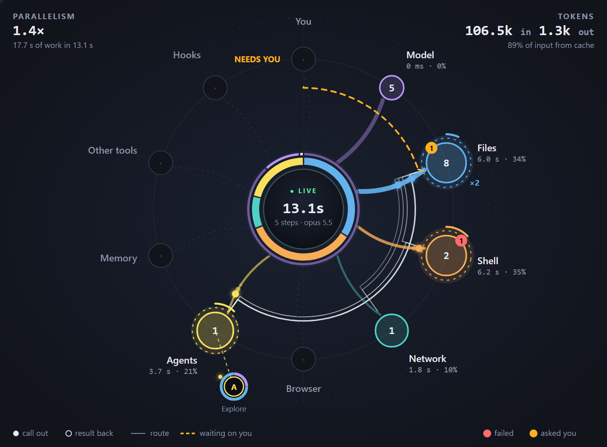
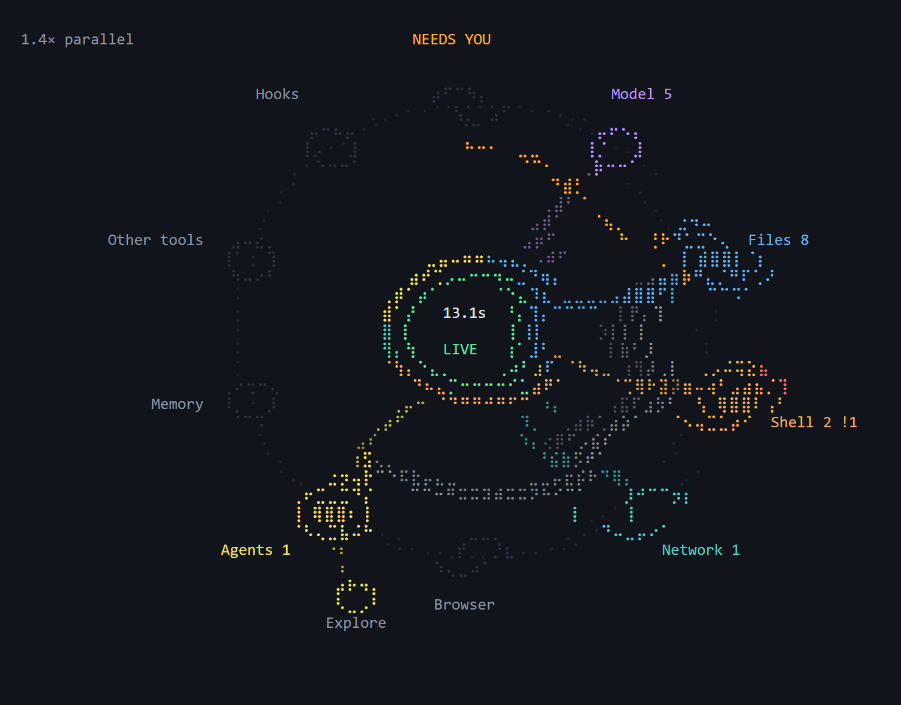
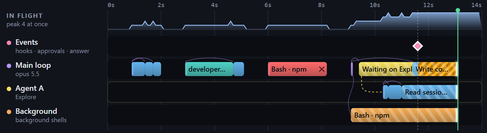
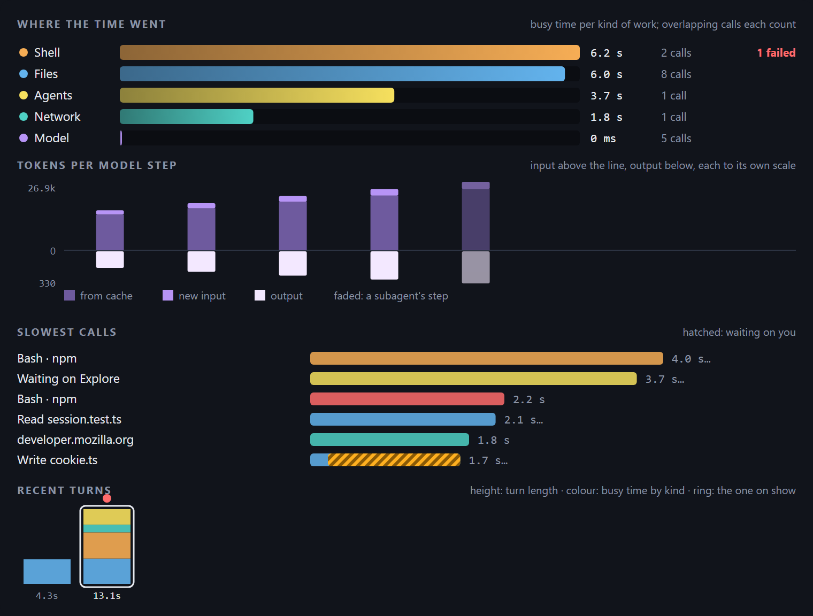

# Agent Trace

A live picture of what Claude Code does in each turn, in a pane beside the chat. It shows model steps, tool calls, subagents, hooks and permission waits three ways: as a **map**, as a **timeline** and as **insights** charts. A summary of the turn sits on top and an inspector shows the span you pick.

It works in the terminal, the desktop app and the VS Code extension. Desktop, VS Code and mobile draw animated vector pictures. The terminal draws the map in coloured braille dots and the timeline in block characters.



*A made-up turn drawn by the mod's own code.*

## The three views

Switch with the **◉ Map**, **▤ Timeline** and **▦ Insights** buttons. The pane remembers your choice.

### Map

The hub in the middle is the main loop. Every kind of work is a station around it: You, Model, Files, Shell, Network, Browser, Agents, Memory, Other tools and Hooks.

- **Pulses.** A running call sends a pulse with a short tail out along its station's spoke, over and over until it ends. Then a comet runs back to the hub and fades. A failed call's comet is red, and its station flashes.
- **Worn spokes.** A spoke grows thicker and brighter the more its station is used. A station grows with the time spent there, and the number inside it counts its calls.
- **Running time.** While a call runs, a dashed ring turns round its station and an arc fills over 30 seconds. `×3` means three calls there at once.
- **Badges.** A red badge counts failures and an amber badge counts calls that waited on you.
- **Needs you.** A call waiting on a permission prompt draws a marching amber line to You, and You pulses until you answer.
- **The route.** The main loop's last few moves between stations run round an inner orbit. The newest leg draws itself in, with an arrowhead.
- **Subagents** are satellites beside Agents, named by their type. A small ring round each shows the mix of their calls.
- **The hub.** It shows the turn's clock and step count. The coloured ring round it splits the busy time by kind of work, and the thin ring outside that splits tokens into cached input, new input and output.
- **Read-outs.** Parallelism, the work done divided by the turn's length, sits top left. Tokens and the cache hit rate sit top right.
- **Station chips.** One chip per station that was used sits under the map. Each one filters the span list to that station's calls.

Hover over a station or a ring segment on desktop for its numbers.

In the terminal, the map is a braille picture whose pulses move a few times a second while a turn runs. Under it, each station is listed in words. The pane needs at least 40 columns for the picture.



### Timeline



- **In flight**: an area chart above the lanes of how many calls ran at once, with the peak.
- **Swimlanes**, one row each:
  - **Events**: hooks that took time or made a decision, permission asks and your answers (diamonds), and the end of the turn.
  - **Main loop**: each model request (`step 1`, `step 2`, …) and each tool call.
  - **Agent A, Agent B, …**: one lane per subagent, named by its type.
  - **Background**: shells sent to the background, still running.
- **Bars** are coloured by kind. A running bar has marching stripes and a bright leading edge. A failed bar is red with a ✕. Time spent waiting on a permission prompt is hatched in amber.
- **Causality.** A thin violet link runs from each model step to the calls it asked for. A dashed yellow link runs from each Agent call to the subagent lane it started.
- **The playhead.** A green line marks now while the turn runs.
- **Filters**: All, Model, Files, Shell, Network, Agents, Hooks, Needs you and Errors.

### Insights



- **Where the time went**: busy time per kind of work, with call and failure counts.
- **Tokens per model step**: input above the line, split into cache reads and new input, and output below it, each on its own scale. A subagent's steps are faded.
- **Slowest calls**: the six longest. The part spent waiting on you is hatched.
- **Recent turns**: one column per turn. Its height is the turn's length and its colours split the busy time by kind. The turn on show is ringed, and a red dot marks a turn with errors.

## Under every view

- **Turn summary**: turn time, model steps, tool calls, errors, time waited on you, parallelism, and tokens in and out.
- **Span list**: newest first, with the current filter applied.
- **Inspector**: the span you pick, with:
  - its kind and lane, status, start time and duration, and its share of the turn
  - the model step that issued it, and its tokens
  - any risk signal: a recursive delete, a force push, or a download piped into a shell
  - its input at the detail level that was kept, and its result
  - **Copy as JSON**, which copies the span
- **History**: the last 10 turns. Use **◀ Older** and **Newer ▶** to move between them.

## Privacy: how much detail is kept

The **Detail kept** buttons at the bottom of the pane decide how much of each call's input is captured. The choice applies to calls from then on and is remembered across sessions.

| Setting | What is kept |
| --- | --- |
| **Names only** (default) | Tool names, file base names, hosts and program names. No arguments and no output. |
| **Masked args** | Arguments, with secrets hidden and long text replaced by its length. |
| **Full input** | Whole arguments, with recognisable keys and tokens still hidden, cut at 4,000 characters. |

The trace is kept in the session's memory and is never written to disk or sent anywhere. Only two choices are stored: the detail level and the view you last picked. See [PRIVACY.md](PRIVACY.md).

## Install

At the prompt of a Claude Code terminal session:

```
/plugin install agent-trace --marketplace ismail102/agent-trace
```

Answer `y` to add the marketplace, then choose a scope.

From a shell:

```
claude plugin install agent-trace --marketplace ismail102/agent-trace
```

If it says the plugin is not found in any marketplace:

```
claude plugin marketplace add ismail102/agent-trace
claude plugin install agent-trace@agent-trace
```

In the desktop app, where `/plugin` does not run: click **+** next to the prompt box, then **Plugins**, **Add marketplace** with `ismail102/agent-trace`, then **Add plugin**.

A plugin installed from a terminal at the user scope also loads in the VS Code extension's sessions.

## Use

The pane opens when a session starts. To open it again, or after turning auto-open off:

```
/agent-trace
```

To empty the trace:

```
/agent-trace clear
```

### Settings

Change these in the config menu (`/config`) under agent-trace:

| Setting | Default | Meaning |
| --- | --- | --- |
| `detail` | `names` | The detail level used until you pick one in the pane: `names`, `masked` or `full`. |
| `autoOpen` | `true` | Open the pane when a session starts. |
| `keepTurns` | `10` | How many recent turns the pane keeps (1 to 50). |

## How it works

Agent Trace is a Claude Code mod: one hooks module (`hooks/register.tsx`) that the engine loads. Every hook only observes. It passes each event on unchanged with `next(e)` and records the time around that call.

| Event | Becomes |
| --- | --- |
| `turn.start` / `turn.complete` | A turn, its subagent lanes, the end marker |
| `turn.step` | A model step with its tokens |
| `tool.call` | A tool-call span, its result and error status |
| `classic.PermissionRequest` + `classic.PostToolUse` | The permission wait: from the ask until the tool began to run (`duration_ms` excludes prompt time) |
| `classic.SubagentStart` | The subagent lane's type |
| `classic.*` | A hook span when a settings hook takes 40 ms or more, or decides something |

The pane redraws once a second while a turn runs. Each SVG animation starts at a negative offset worked out from the clock, so a redraw carries on from where the last one stood instead of starting over. In the terminal, a frame loop repaints the braille map in place with `$.ui.blit` five times a second, and only while the live turn is on show.

The files:

```
.claude-plugin/plugin.json       the manifest and its settings
.claude-plugin/marketplace.json  makes this repo its own marketplace
hooks/hooks.json                 names the hooks module
hooks/register.tsx               the hooks
hooks/capture.ts                 categories, labels, masking, risk signals
hooks/trace.ts                   pure updates to the recorded trace
hooks/scene.ts                   the map's model: stations, pulses, route, satellites
hooks/mapsvg.ts                  the animated SVG map
hooks/braille.ts                 the terminal's braille map, packed as Raster cells
hooks/insights.tsx               the Insights charts
hooks/palette.ts                 colours
hooks/draw.tsx                   the pane: views, timeline, span list, inspector
hooks/agent-trace.test.tsx       tests, run on every surface
types/index.d.ts                 the state contract
```

## Develop

```
claude plugin validate .
claude plugin test .
```

To run it from this folder without installing it:

```
claude --plugin-dir .
```

Built and tested on Claude Code 2.1.322. The mod API is in early access and may change between releases.

## License

MIT. See [LICENSE](LICENSE).
